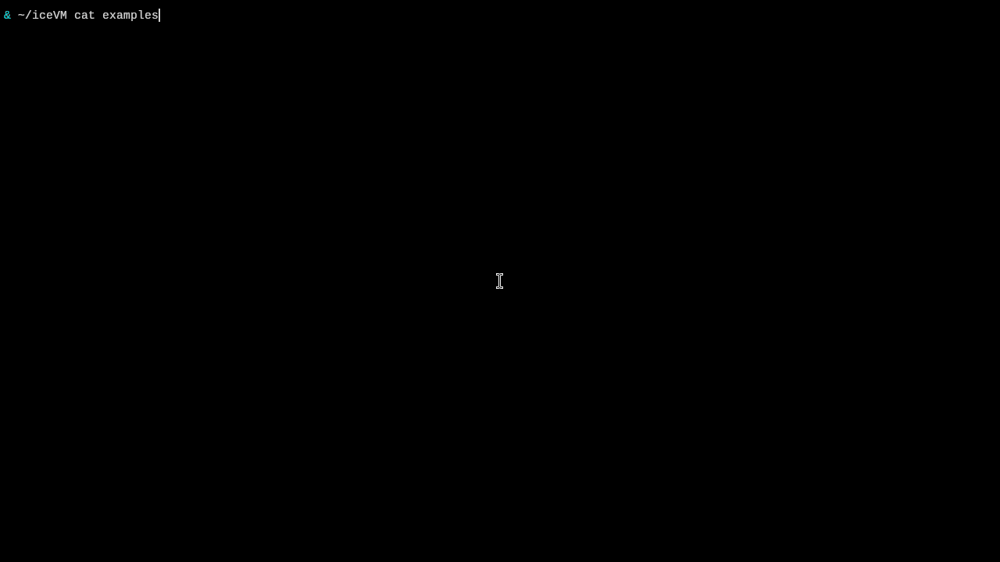

# iceVM

iceVM implements a register VM + Rocq compiler and checked bytecode optimisations

The VM itself is small with 16 64 bit register with  byte addressable memory and an explicit call stack while the Rocq makes decoding failures and runtime traps part of the execution model

The compiler proof accounts for recursion + faults and the extra instructions introduced during compilation. Optimisation candidates go through a checker that proves they preserve results along with traps and divergence while the C runtime  has VST proofs (though these show partial correctness under allocator contracts and still leave extraction + the host compiler and I/O trusted)